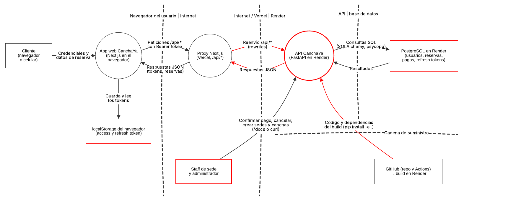

# Lab 1 · Modelo de amenazas de CanchaYa

**Equipo:** Mateo Arroyave (mateoaamm), Nombre Apellido (usuario2)
**Aplicación:** CanchaYa, API de reservas de canchas sintéticas (FastAPI + PostgreSQL en Render) con frontend Next.js.
**Archivos:** `modelo.json` (Threat Dragon 2.6), `informe.pdf` (botón *Report*) y `dfd.png` (el diagrama).

Acotamos el modelo a un flujo de negocio completo: registro → login → consulta de disponibilidad → reserva → confirmación del pago por el staff → cancelación. Las amenazas salen de revisar el código del repositorio (`mateoaamm/canchaya`), por eso varias citan archivo y línea.

## 1. ¿En qué estamos trabajando?

| Tipo | Elementos |
|---|---|
| Actores | Cliente (navegador o celular); staff de sede y administrador, que usan la API directo por `/docs` o `curl` porque el frontend solo tiene vistas de cliente; GitHub (repo y Actions), que dispara el build en Render |
| Procesos | App web Next.js en el navegador; proxy de Next.js en Vercel (rewrites de `/api/*`); API FastAPI en Render |
| Almacenes | `localStorage` del navegador (access y refresh token); PostgreSQL en Render (usuarios, reservas, pagos, refresh tokens) |
| Flujos | Peticiones `/api/*` con Bearer token (HTTPS, red pública); reenvío Vercel → Render (HTTPS, red pública); consultas SQL (red privada de Render, sin `sslmode=require`); operaciones de staff y admin (HTTPS); código y dependencias del build (HTTPS) |

Límites de confianza: navegador del usuario | Internet, Internet/Vercel | Render, API | base de datos, y la cadena de suministro (GitHub → build de Render).

## 2. ¿Qué puede salir mal?

Recorrimos cada elemento con STRIDE y quedaron 14 amenazas, con las seis letras representadas. T2 y T5 son de lógica de negocio: el código hace lo que dice, el problema está en la regla.

Para calificar usamos estos criterios:

- **Impacto.** 3 = control de una cuenta privilegiada, pérdida económica o exposición de toda la base. 2 = afecta a usuarios individuales o a la disponibilidad de una sede. 1 = información que facilita otro ataque.
- **Probabilidad.** 3 = se explota hoy con lo que es público, sin condiciones. 2 = necesita una condición adicional plausible (una mala configuración, un token robado). 1 = exige comprometer antes otra pieza (un XSS, una dependencia, la filtración de un secreto).

| ID | Elemento | STRIDE | Amenaza | I | P | Riesgo |
|---|---|---|---|---|---|---|
| T1 | API | S | Cuentas del seed con contraseñas publicadas en el repositorio y cargadas en producción | 3 | 3 | 9 High |
| T2 | API | T | Cancelar una reserva ya jugada deja el pago como `refunded` (lógica de negocio) | 3 | 3 | 9 High |
| T3 | API | S | Fuerza bruta y credential stuffing en `/auth/login` | 2 | 3 | 6 Medium |
| T4 | API | E | `SECRET_KEY` con valor por defecto en el código: se pueden forjar tokens de admin | 3 | 2 | 6 Medium |
| T5 | API | D | Acaparamiento de horarios con reservas `pending` que nunca se pagan (lógica de negocio) | 2 | 3 | 6 Medium |
| T6 | API | S | Refresh token sin rotación: uno robado sirve 7 días | 2 | 2 | 4 Medium |
| T7 | Staff y admin | R | No queda rastro de quién confirmó un pago o canceló una reserva | 2 | 2 | 4 Medium |
| T8 | API | S | El registro acepta cualquier contraseña | 2 | 2 | 4 Medium |
| T9 | Proxy → API | D | Sin límite de solicitudes en una instancia pequeña (bcrypt y listados sin paginar) | 2 | 2 | 4 Medium |
| T10 | localStorage | I | Tokens en `localStorage` al alcance de cualquier XSS | 3 | 1 | 3 Low |
| T11 | PostgreSQL | I | Base de datos con acceso externo abierto (regla 0.0.0.0/0 de Render) | 3 | 1 | 3 Low |
| T12 | GitHub → API | T | El build de Render instala versiones distintas a las probadas en el CI | 3 | 1 | 3 Low |
| T13 | API → proxy | I | Enumeración de correos registrados (mensaje del registro y tiempos del login) | 1 | 3 | 3 Low |
| T14 | API | I | Swagger (`/docs`) y `/openapi.json` públicos en producción | 1 | 3 | 3 Low |

La descripción completa de cada amenaza, con su mitigación, está en `modelo.json` y en `informe.pdf`.

## 3. ¿Qué vamos a hacer al respecto?

Las cinco de mayor riesgo son T1 y T2 (9) y T3, T4 y T5 (6).

| ID | Amenaza | STRIDE | I × P | Requisito de seguridad (verificable) | ASVS 5.0 | Cómo lo verificamos |
|---|---|---|---|---|---|---|
| T1 | `scripts/seed.py` crea admin, staff y cliente con contraseñas fijas que están en el repositorio público, y ese seed se corrió contra la base de producción | S | 3 × 3 = 9 | En producción no existe ninguna cuenta con credenciales por defecto o publicadas. `seed.py` aborta si `APP_ENV=production` y las cuentas iniciales se crean con una contraseña aleatoria que se cambia en el primer ingreso. | V6 (6.3.2) y V15 (15.2.3) | Prueba de humo: login con las credenciales del seed contra el despliegue, debe responder 401. Test: `seed.py` con `APP_ENV=production` termina con error. |
| T2 | Un cliente cancela una reserva confirmada después de jugar y el pago pasa a `refunded` sin regla de tiempo ni aprobación (`bookings.py:114-134`) | T | 3 × 3 = 9 | Un cliente solo puede cancelar hasta 2 horas antes de `start_time` (el plazo lo define la sede); después la API responde 409 y ni la reserva ni el pago cambian. El staff y el admin no tienen ese límite (su rastro es T7). | V2 (2.3.1 y 2.3.2) | `tests/test_bookings_cancel_deadline.py`: un partido ya jugado y uno que empieza en 1 hora responden 409 con el pago en `paid`; cancelar 3 días antes sigue reembolsando. |
| T3 | `/auth/login` no limita intentos; además, detrás del proxy de Vercel la API no ve la IP real del cliente | S | 2 × 3 = 6 | Tras 5 intentos fallidos para el mismo correo en 15 minutos, `/auth/login` responde 429 durante 15 minutos. Hay un límite adicional por IP real, tomada de `X-Forwarded-For` solo cuando viene del proxy, y cada intento fallido queda registrado. | V6 (6.3.1) y V15 (15.3.4) | Test: 6 intentos fallidos con el mismo correo; el sexto debe responder 429. |
| T4 | `config.py:30` trae un `secret_key` por defecto: un despliegue sin la variable firma los JWT con una llave pública y cualquiera forja un token de admin | E | 3 × 2 = 6 | La API no arranca si `SECRET_KEY` falta o tiene menos de 32 bytes; el código no tiene valor por defecto y la llave vive solo en el gestor de secretos de la plataforma. | V13 (13.3.1) y V9 (9.1.1) | Test: `Settings()` sin `SECRET_KEY` lanza `ValidationError`. Regla de Semgrep en el AuditGate que marque secretos con valor por defecto. |
| T5 | Las reservas `pending` no tienen tope por usuario, ni fecha máxima, ni vencimiento: con varias cuentas se bloquea una cancha por semanas | D | 2 × 3 = 6 | Máximo 2 reservas pendientes por cliente; se reserva con hasta 30 días de anticipación; una reserva `pending` sin pago confirmado se cancela sola a los 30 minutos y libera el horario. | V2 (2.1.3, 2.3.2 y 2.4.1) | Tests: la tercera pendiente responde 409; una fecha a 31 días responde 422; la tarea de expiración cancela una pendiente vencida y el horario vuelve a aparecer en `/availability`. |

Los valores de T2 y T5 (2 horas, 2 reservas, 30 días, 30 minutos) son una propuesta nuestra; el plazo real lo debe fijar el negocio, pero el requisito se prueba igual con cualquier valor.

## 4. ¿Hicimos un buen trabajo?

**¿Qué quedó fuera?** El entorno local, la configuración interna de Vercel y Render, el código de `canchaya-web` (lo modelamos por su documentación) y el pago, que hoy es simulado; una pasarela real abriría un límite nuevo con webhooks.

**¿Qué amenaza nos sorprendió?** T2: el proyecto ya probaba IDOR y concurrencia, pero la regla de cancelación permite registrar el reembolso de un partido ya jugado, y eso no lo detecta ningún escáner.
